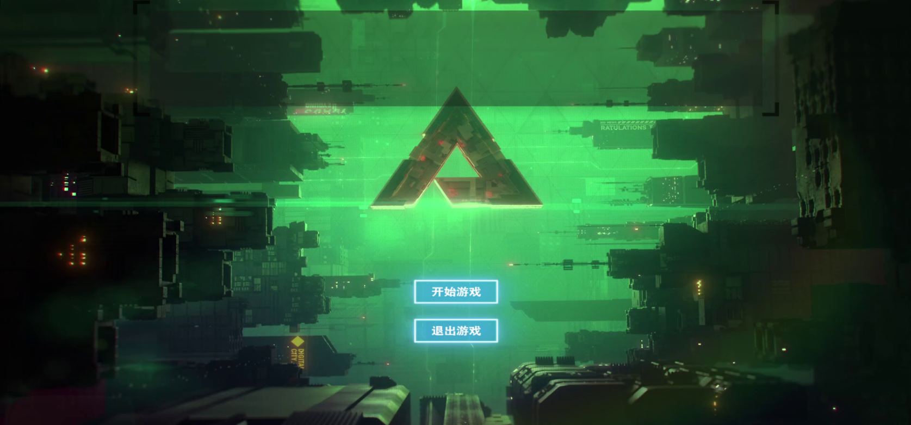
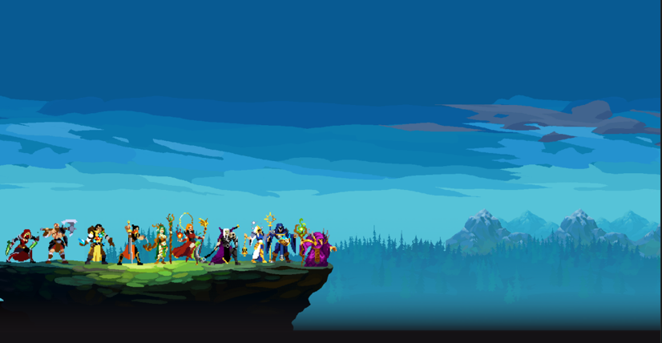
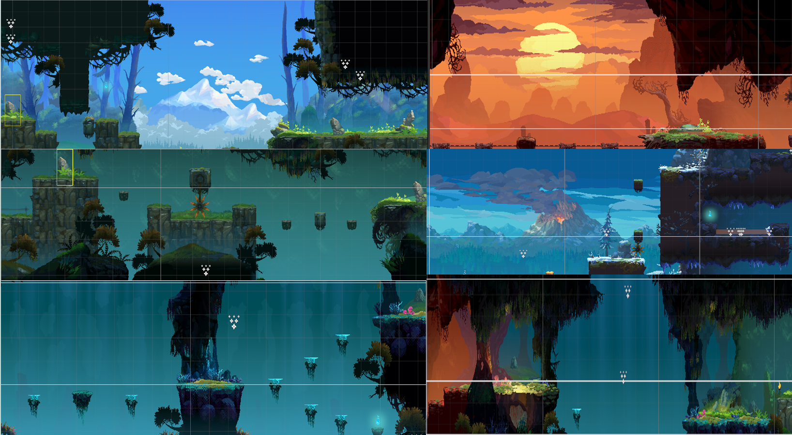
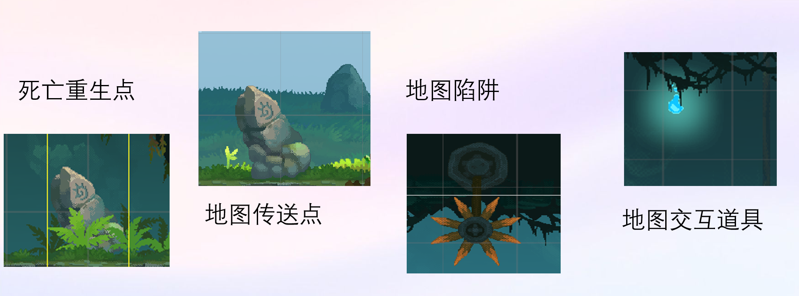
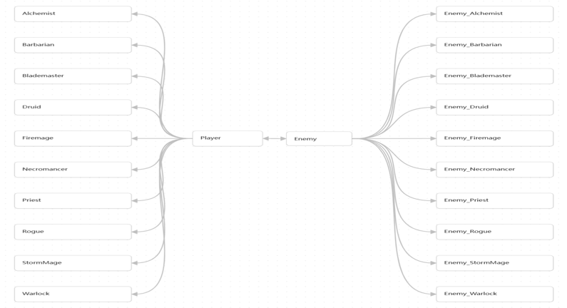
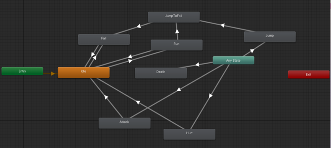

# Back To Dawn

> 基于 Unity 与 C# 开发的 2D 横版动作冒险游戏（课程实践项目）。

## 项目简介

《Back To Dawn》采用像素风格，以**时间线回溯与记忆继承**为核心叙事设计。玩家在不同场景中操控角色，经历移动、跳跃、攻击、技能释放与敌人战斗；随着关卡推进，通过分支选择进入不同路径，并从不同角色视角逐步了解故事。

本项目围绕角色控制、战斗交互、敌人 AI、场景切换、检查点与重生、UI 及剧情视频等功能展开。

## 技术栈

- **引擎**：Unity 2021.3 LTS
- **语言**：C#
- **游戏类型**：2D 横版动作冒险
- **主要技术**：Rigidbody2D、Collider2D、Animator、协程、接口、状态管理
- **运行平台**：Windows 10/11（64 位）

## 游戏流程

1. 从 `Gamestart` 开始游戏。
2. 进入横版战斗场景，通过分支选择改变后续关卡路径。
3. 在各场景中控制角色，完成战斗与探索。
4. 最终进入 `Demo_10`，跳转至结尾 CG；CG 播放完毕后退出游戏。

**场景位置**：`Assets/PlopSaga_v3.0/Scenes/`

> 注意：不同分支或运行环境下，部分路径与角色模型可能出现适配问题；必要时可在对应主角的 C# 行为脚本中显式调整相关配置或逻辑。
## 游戏展示

### 开始界面


### 角色展示


### 美术风格


### 游戏交互


### 游戏逻辑


### 状态管理

## 主要功能

| 模块 | 功能说明 |
| --- | --- |
| 角色控制 | 实现移动、跳跃、翻滚、攻击、技能、受伤、死亡及复活等行为，并配合动画状态切换。 |
| 战斗系统 | 使用 `IDamageable` 接口统一受击交互，结合 2D 碰撞与范围检测完成伤害判定、击退等逻辑。 |
| 敌人 AI | 根据玩家距离及角色状态实现基础巡逻、追击、攻击等行为；不同敌人具有不同技能或战斗特点。 |
| 游戏流程 | 实现场景切换、分支选择、开始页面与结尾 CG 播放。 |
| 辅助系统 | 包含血条、检查点、重生、陷阱、商店、音乐与游戏特效等功能。 |
| 调试与防护 | 使用 `Debug` 日志、`Gizmos` 和空引用/组件缺失检查辅助定位问题。 |

## 项目目录说明

以下为 Unity 项目中主要目录（路径均相对于项目根目录）：

```text
BackToDawn/
├── Assets/
│   ├── PlopSaga_v3.0/
│   │   └── Scenes/                  # 游戏场景；从 Gamestart 开始，最终到 Demo_10
│   ├── Pixel Heroes Pack/
│   │   └── Demo/
│   │       └── Scripts/             # 玩家角色行为脚本
│   ├── Scripts/                     # 敌人 AI 与场景切换、血条、重生、陷阱等功能
│   ├── Audio/                       # 游戏音乐与音效
│   ├── CheckPoint/                  # 检查点与重生点相关资源
│   ├── Shop/                        # 游戏商店相关内容
│   ├── Video/                       # 过场和结尾等视频资源
│   └── 特效/                         # 游戏视觉特效
├── Packages/                        # Unity 包依赖
└── ProjectSettings/                 # Unity 项目设置
```

**资源说明**：地图原型基于 **PLopSaga**，核心角色组件位于 **Pixel Heroes Pack**。项目在这些资源基础上编写与整合角色行为、敌人逻辑及游戏功能。

## 本地运行

1. 安装 **Unity Hub** 和 **Unity 2021.3 LTS** 编辑器，建议使用 Windows 10/11 64 位系统。
2. 克隆本仓库：

   ```bash
   git clone https://github.com/Liu16256/BackToDawn.git
   ```

3. 在 Unity Hub 中选择 **Add / 从磁盘添加项目**，选中包含 `Assets`、`Packages`、`ProjectSettings` 的 `BackToDawn` 文件夹。
4. 首次导入后，在 Unity 中打开 `Assets/PlopSaga_v3.0/Scenes/Gamestart` 对应的场景文件，点击 **Play** 开始体验。
5. 如果出现脚本、资源引用或场景跳转问题，检查 Console 日志、对象组件配置、场景构建列表与分支对应的角色脚本。

> 仓库包含较大的视频资源，首次克隆与 Unity 导入可能需要一定时间。

## 项目实现重点

- **接口化战斗交互**：通过 `IDamageable` 降低玩家和不同敌人之间的直接依赖。
- **状态与行为拆分**：对移动、攻击、死亡等状态进行控制，将敌人的巡逻、追击与攻击逻辑拆分为独立方法。
- **物理与动画协同**：通过 2D 刚体、碰撞体和 Animator 实现动作及战斗反馈。
- **功能调试**：通过日志输出、检测范围可视化及基础异常检查排查问题。

## 已知问题与后续计划

- 当前敌人 AI 主要基于状态和距离判断，尚未加入完整的路径寻路系统。
- 某些分支路径及角色模型在不同运行环境下可能需要手动适配。
- 后续可进一步优化动画事件与特效触发的同步，以及 CG 播放、场景衔接等细节。

## 致谢与资源说明

感谢 **PLopSaga** 地图原型与 **Pixel Heroes Pack** 角色资源的原作者。相关第三方素材版权归各自权利人所有；若需二次分发或商用，请以对应素材的授权条款为准。

---

本项目用于 Unity 2D 游戏开发学习与课程实践展示。
